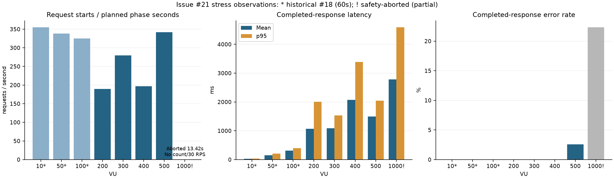
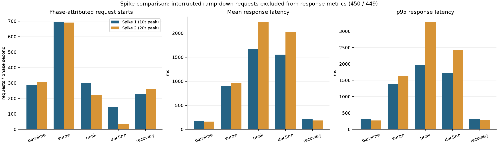

# 이슈 #21 단일 서버 부하 테스트 최종 보고서

작성·원문 확인: 2026-10-27 / [GitHub 이슈 #21](https://github.com/CD-BTS/ticket-fds-backend/issues/21) — **[Test] Event API 확장 부하 및 Spike Test**

**종료 판정: 현재 증빙만으로 모든 요구사항 완료를 선언해 바로 닫는 것은 권고하지 않는다.** 테스트 수행·분석·Redis 이전 Baseline 문서화는 완료했지만, MySQL 직접 CPU·메모리 및 200·300·400 VU DB 전후 검증 증빙이 없다. 1,000 VU는 보호 중단 결과다. 기존 증빙 보완 또는 해당 범위 예외의 명시적 수용이 필요하다. 이번 작업은 추가 부하 테스트·DB/서버 변경·커밋·GitHub 이슈 수정 없이 기존 파일만 분석했다.

## 1. 원래 요구사항과 완료 조건 대조

GitHub 원문은 읽기 전용 인증 조회로 확인했다. 원문 체크박스는 여전히 미선택이며 자동 수정하지 않았다. 아래 상태는 체크박스 선택 여부와 구별한 증빙 기반 평가다.

| 작업 요구사항 | 판정 | 근거·한계 |
|---|---|---|
| 확장 200 / 500 / 1,000 VU 테스트 | 부분 완료 | 200·500 완료, 1,000 VU는 메모리 보호로 13.42초 조기 중단. 300·400 추가 관찰. |
| VU별 RPS·평균·p95·오류율 | 완료 | 아래 표와 선택 실행 RUN_ID 및 집계 기준으로 추적 가능. |
| Spring Boot 및 MySQL CPU·메모리 확인 | 미충족 | Java·시스템·k6 측정은 있음. MySQL 프로세스/컨테이너 직접 CPU·메모리 측정은 기존 파일에서 확인하지 못함. 시스템 CPU를 MySQL 값으로 대체하지 않음. |
| 요청 성공 건수와 실제 DB 적재 비교 | 부분 완료 | 500·1,000·Spike 1·2는 전후/고유/중복 대조. 200·300·400은 원본 DB 전후 증빙 부재. |
| 부하 증가에 따른 저하·병목 분석 | 완료(범위 제한) | 지연·오류·공유 PC 자원 압박 관찰. 서버 단독 한계/SQL 병목 원인은 확정하지 않음. |
| 순간 급증 재현·처리량·p95·오류율 | 완료 | ramping-vus, 50→500→50, 고부하 유지 10초와 20초 각각 1회. |
| 감소 후 정상 상태 회복 확인 | 완료(부분 회복 관찰) | 서버 정상 응답·오류 0 확인. 평균·처리량은 각 실행 초기 기준까지 완전히 회복하지 않음. |
| 지속 부하와 Spike 결과 비교 | 완료 | 서로 다른 준비 부하·유지 시간·취소 정책을 명시하여 비교. |
| VU별 결과 표 및 그래프 | 완료 | 본 보고서와 PNG 2개. 10~100은 과거 #18 결과로 분리. |
| 단일 서버 처리 한계·주요 병목 분석 | 완료(범위 제한) | 500에서 연결 거부, 1,000에서 메모리 보호 중단. 독립 부하 발생기·MySQL 계측 없이 서버 고유 한계 확정 불가. |
| Redis 대기열 전 기준 데이터 | 완료(탐색적 Baseline) | 집계 지표·조건·관찰 한계·입력 파일 해시를 저장. Redis 효과나 필요성을 증명한 결과는 아님. |

| 완료 조건 원문 | 현재 평가 |
|---|---|
| 확장 부하 및 Spike Test 수행 완료 | 부분: 200/500·Spike 1/2 완료, 1,000 안전 중단을 완료 범위로 수용할지 결정 필요 |
| 요청 성공 건수와 DB 적재 건수 일치 여부 검증 | 부분: 500/1,000/Spike는 검증, 200/300/400 원본 증빙 미확인 |
| RPS, p95, 오류율, CPU·메모리 측정 결과 정리 | 부분: RPS·지연·오류·Java/시스템 정리, MySQL 직접 측정 누락 |
| 테스트 결과 및 분석 내용 문서화 | 완료: 본 문서·그래프·정제 지표·Git 및 민감정보 검토 |

부하 중 오류/threshold FAIL 자체는 성능 한계 관찰의 결과이며 테스트 수행 실패와 동일하지 않다. 원문에는 모든 VU의 성공률 99% 유지나 특정 응답 시간 SLA 달성이 완료 조건으로 명시되어 있지 않다.

## 2. 환경과 지표 정의

- 대상: `POST /api/v1/events`, BOOKING 이벤트. 기존 API 인증과 등록 사용자 100개 재사용, 요청마다 새 external event ID.
- Windows PC 1대에서 Spring Boot·k6·Docker MySQL 실행. 논리 CPU 8개, 가시 RAM 약 7,893 MiB. API loopback:8080, MySQL 로컬 host port 3307. MySQL 8.0 이미지를 사용했으며 정확한 패치 버전은 보관 자료로 확정하지 않았다.
- k6 2.2.0은 작업 중 확인됨. 빌드 toolchain은 JDK 17이나 테스트 시 JVM 정확한 버전은 보관 자료로 확인하지 못했다.
- 응답 시간은 `http_req_duration`: 송신·대기·수신 시간이며 연결/대기열/전체 사용자 경험 시간을 모두 포함하는 종단 지연은 아니다.
- 시작 RPS는 해당 구간에서 시작한 요청 수 ÷ 구간 설정 초. k6 RPS는 완료 HTTP 요청 수 ÷ 실제 전체 실행 시간. 최종 grace에서 완료된 응답도 포함한다. 두 기준을 혼용하지 않는다.
- Spike 응답은 시작 구간에 귀속한다. 1초 ramp의 시작 RPS는 정상 상태 처리 용량이 아니다. 감소 시 취소된 요청은 응답 기반 성공률·오류율·지연에서 빠지므로 별도 표시한다.
- CPU는 논리 CPU 전체를 100%로 정규화. 메모리는 상주/프로세스 private committed 값이며 JVM heap과 다르다. 자원 통계는 1초 sleep+CIM 수집으로 불규칙한 표본의 단순 평균/최대다.

## 3. Stress/기존 Load 결과: 10~1,000 VU

**10·50·100 VU는 #18 당시 각 60초 측정한 과거 참조값**이다. 이를 #21의 동일 조건 30초 Stress 재실행으로 표시하지 않는다. #21 정식 비교는 각 30초 200·300·400·500과 조기 중단 1,000이다.

| VU | 구분/시간 | 시도 | 시작 RPS | k6 RPS | 평균 ms | p95 ms | 성공 % | 오류 % | 네트워크 실패 |
|---|---|---|---|---|---|---|---|---|---|
| 10 | #18 과거 / 60s | 21310 | 355.17 | — | 27.68 | 38.42 | 100.00 | 0.00 | 미별도집계 |
| 50 | #18 과거 / 60s | 20305 | 338.42 | — | 147.24 | 206.21 | 100.00 | 0.00 | 미별도집계 |
| 100 | #18 과거 / 60s | 19484 | 324.73 | — | 308.18 | 396.51 | 100.00 | 0.00 | 미별도집계 |
| 200 | 완료 / 30s | 5678 | 189.27 | 184.47 | 1,067.89 | 2,004.99 | 100.00 | 0.00 | 0 |
| 300 | 완료 / 30s | 8378 | 279.27 | 270.73 | 1,085.71 | 1,531.02 | 100.00 | 0.00 | 0 |
| 400 | 완료 / 30s | 5909 | 196.97 | 186.19 | 2,074.65 | 3,389.87 | 100.00 | 0.00 | 0 |
| 500 | 완료 / 30s | 10253 | 341.77 | 319.37 | 1,499.35 | 2,040.41 | 97.44 | 2.56 | 262 |
| 1000 | 조기 중단 / 13.42s | 4213 | N/A | 239.44 | 2,782.71 | 4,591.98 | 77.66 | 22.34 | 718 |

- 200→300 VU: 시작 RPS 189.27→279.27, 평균 1,067.89→1,085.71 ms. 400 VU는 RPS 196.97로 감소하고 평균 2,074.65 ms로 증가.
- 500 VU: 10,253 시도 / 9,991 확인 성공 / 연결 거부 262, HTTP 오류 응답 0. 성공률 97.44%로 threshold 실패(exit 99). 오류 로그는 시작 시점 `dial: connection refused`, status 0, 상세 code 1212.
- 1,000 VU: 가용 RAM 64 MiB 미만으로 약 13.422856초에 중단(exit 103). 4,213 시도 중 응답 표본 3,214 = 성공 2,496 + 연결 거부 718; HTTP 오류 응답 0. 미완료 999건은 성공률/오류율 분모에 포함되지 않는다.
- 1,000의 시도/30초=140.43과 확인 성공/30초=83.20은 실제 처리량이 아니다. 부분 실행 완료 요청 k6 RPS 239.44만 관찰값으로 보관하며 완료 30초 결과와 동일 취급하지 않는다.
- 500이 400보다 높은 처리량을 보이는 등 비단조적 결과이므로 안정적인 최대 RPS나 서버 단독 최대 VU를 산출하지 않는다. 1,000은 공유 PC 자원 한계 관찰이다.

### 선택한 실행과 제외한 기록

| 대상 | 선택 RUN_ID |
|---|---|
| 10/50/100 (#18) | ff3426d2-3b53-47aa-b3f2-f76933ec6744 |
| Stress 200 | b6536e3d-f6a4-4a3f-9f49-da299e3a732f |
| Stress 300 | d7670ad9-e74a-4323-aa99-fded01c09d19 |
| Stress 400 | 62ea94d5-f972-41bb-b90b-9e995a879da4 |
| Stress 500 | 4f8fbf55-c380-412f-b2cc-f0c0325e1120 |
| Stress 1000 | 48d87476-3e28-4d24-b35d-ac35f071b4ab |
| Spike 1 | 7e3352c8-b82d-4034-8048-6f250fa5d430 |
| Spike 2 | cb71518d-91c1-4a3c-ae67-31147d4792ec |

동일 디렉터리의 다른 200/500 실행은 이전 실행·짧은 점검 기록 등을 포함하므로 위 대표 실행과 합산하지 않았다. 특히 200 VU의 과거 330.73 RPS 결과를 최신 189.27 RPS와 혼합하지 않는다. 각 입력 파일의 SHA-256은 `issue21-artifacts/baseline-metrics.json`에 저장했다.

## 4. Spike 1·2차: 구간별 성능과 취소 요청

### 1차: 고부하 10초, 총 42초

| 구간 | 초 | 시작 RPS | 확인 성공/s | 평균 ms | p95 ms | 성공 % | 오류 % | 응답 확인 중단 |
|---|---|---|---|---|---|---|---|---|
| baseline | 0~10 | 287.20 | 287.20 | 174.53 | 317.50 | 100.00 | 0.00 | 0 |
| surge | 10~11 | 694.00 | 694.00 | 903.87 | 1,393.29 | 100.00 | 0.00 | 0 |
| peak | 11~21 | 302.30 | 268.60 | 1,672.73 | 1,972.61 | 100.00 | 0.00 | 337 |
| decline | 21~22 | 145.00 | 32.00 | 1,556.86 | 1,709.89 | 100.00 | 0.00 | 113 |
| recovery | 22~42 | 229.90 | 229.90 | 209.36 | 304.12 | 100.00 | 0.00 | 0 |

### 2차: 고부하 20초, 총 52초

| 구간 | 초 | 시작 RPS | 확인 성공/s | 평균 ms | p95 ms | 성공 % | 오류 % | 응답 확인 중단 |
|---|---|---|---|---|---|---|---|---|
| baseline | 0~10 | 305.30 | 305.30 | 163.91 | 275.99 | 100.00 | 0.00 | 0 |
| surge | 10~11 | 691.00 | 691.00 | 964.69 | 1,627.07 | 100.00 | 0.00 | 0 |
| peak | 11~31 | 220.35 | 199.25 | 2,231.19 | 3,281.16 | 100.00 | 0.00 | 422 |
| decline | 31~32 | 34.00 | 7.00 | 2,025.06 | 2,433.53 | 100.00 | 0.00 | 27 |
| recovery | 32~52 | 259.90 | 259.90 | 183.43 | 280.25 | 100.00 | 0.00 | 0 |

두 실행 모두 HTTP·네트워크 오류·연결 거부 0건, 응답 표본 성공률 100%, 종료 코드 0. 그러나 1차 450건, 2차 449건은 `gracefulRampDown=0s`에 따른 클라이언트 응답 확인 중단이다. 서버 실패나 100% 응답 확인으로 오해하면 안 된다.

두 시나리오 모두 하나의 `ramping-vus`, 50→500 1초 ramp와 500→50 1초 ramp를 사용했다. 요청 시작 시각은 모든 계획 구간 안에 있었고 매초 VU 표본을 확보했다. 1차 초기 활성화 14→50, peak 경계 한 표본 499→500의 스케줄링 과도 현상은 존재한다. 2차 baseline=50, peak=500, recovery=50으로 관찰됐다. 최종 종료 grace는 10초이며 실제 완료 지표 시간은 약 42.15/52.14초다.

2차 peak는 1차 대비 시작 RPS **-27.11%**, 확인 성공/s **-25.82%**, 평균 **+33.39%**, p95 **+66.34%**. 유지 시간을 늘렸을 때 지연·처리량 저하가 관찰됐으나 오류가 생기지는 않았다. PC 초기 상태와 캐시/DB 누적량이 달라 유지 시간만의 인과 효과로 단정할 수 없다.

### 회복 구간 전·후반 10초

| 실행/구간 | 초 | 확인 성공/s | 평균 ms | p95 ms | 오류 % |
|---|---|---|---|---|---|
| 1차 early | 22~32 | 207.30 | 224.67 | 341.17 | 0.00 |
| 1차 late | 32~42 | 252.50 | 196.79 | 272.98 | 0.00 |
| 2차 early | 32~42 | 240.20 | 190.65 | 296.58 | 0.00 |
| 2차 late | 42~52 | 279.60 | 177.22 | 272.25 | 0.00 |

- 1차 후반: 초기 평균 대비 +12.75%, p95 -14.02%, 처리량 -12.08%. 2차 후반: 초기 평균 +8.12%, p95 -1.36%, 처리량 -8.42%.
- 오류율·p95는 회복했으나 평균과 처리량은 실행 초기 수준에 완전히 복귀하지 않았다. 임의 SLA를 만들어 완전 회복 PASS로 판정하지 않는다. 종료 후 인증된 서버 GET은 두 실행 모두 HTTP 200이었다.
- Stress 500은 처음부터 500 VU·30초이고 Spike는 저부하 준비 뒤 500 VU를 유지한다. Stress의 연결 거부 262와 Spike의 0은 조건이 다른 관찰이며 서버가 개선됐거나 Redis가 필요/불필요하다는 증거가 아니다.

## 5. CPU·메모리 및 MySQL 계측 누락

| 실행 | 표본 | 시스템 CPU 평균/최대 % | Java CPU 평균/최대 % | Java 상주 평균/최대 MiB | Java private 평균/최대 MiB | 최소 가용 RAM MiB | MySQL 직접 CPU/메모리 |
|---|---|---|---|---|---|---|---|
| Stress 200 | 미측정 | 미측정/미측정 | 미측정/미측정 | 미측정/미측정 | 미측정/미측정 | 기록 없음 | 미측정 |
| Stress 300 | 11 | 95.18/100.00 | 16.42/20.25 | 145.46/149.20 | 372.59/372.88 | 기록 없음 | 미측정 |
| Stress 400 | 8 | 96.25/100.00 | 12.58/18.56 | 121.69/127.65 | 372.51/372.83 | 기록 없음 | 미측정 |
| Stress 500 | 17 | 91.35/100.00 | 18.76/23.46 | 177.91/185.71 | 432.45/436.25 | 기록 없음 | 미측정 |
| Stress 1000 | 5 | 96.80/100.00 | 12.14/14.06 | 205.62/220.25 | 436.40/436.80 | <64 (중단) | 미측정 |
| Spike 1 | 18 | 94.78/100.00 | 17.00/21.95 | 141.36/145.78 | 435.93/436.88 | 202.62 | 미측정 |
| Spike 2 | 30 | 96.03/100.00 | 15.84/22.79 | 154.87/181.53 | 479.04/496.02 | 151.86 | 미측정 |

10~100의 자원 원본과 Stress 200 자원 기록은 확인되지 않았다. 300은 exit code 필드가 null이지만 보고서가 생성되고 프로세스가 종료됐다. MySQL 컨테이너/프로세스별 CPU·메모리 시계열은 어느 대표 실행에도 없다. 사후 현재 상태 조회로 당시 값을 대체하거나 시스템 전체 CPU에서 MySQL 사용량을 추정하지 않았다.

공유 PC에서 시스템 CPU가 95~100%에 근접해도 Java CPU는 이보다 낮다. k6·MySQL/Docker·다른 프로그램·계측 비용이 함께 포함된다. 특히 1,000 보호 중단과 2차 Spike 최소 151.86 MiB는 호스트 메모리 압박을 보여 준다. JVM heap/GC, MySQL 쿼리 지연·락·연결 풀, accept queue 포화가 직접 계측되지 않아 근본 병목을 확정하지 못한다.

## 6. DB 검증과 취소/오류 구분

| 실행 | 부하 직전 전체 | 부하 후 전체 | 증가/고유 RUN 이벤트 | 확인 성공 | 미확인/취소 | 전체 중복 키 그룹 |
|---|---|---|---|---|---|---|
| Stress 500 | 163922 | 173913 | 9991 | 9991 | 0 | 0 |
| Stress 1000 | 173914 | 177409 | 3495 | 2496 | 999 | 0 |
| Spike 1 | 177410 | 188742 | 11332 | 10882 | 450 | 0 |
| Spike 2 | 188743 | 202126 | 13383 | 12934 | 449 | 0 |

- Stress 500: 10,253 시도 = DB 9,991 + 연결 거부 262. 1,000: 4,213 시도 = DB 3,495 + 연결 거부 718. 1,000의 DB 3,495 = 확인 성공 2,496 + 중단 후 서버 처리된 것으로 설명되는 999.
- Spike 1: 11,332 시도 = 확인 10,882 + 취소 450 = DB 11,332. Spike 2: 13,383 시도 = 확인 12,934 + 취소 449 = DB 13,383. phase별 적재 수도 대조했고 모든 RUN 이벤트는 고유했다.
- 위 4회 각각 인증 확인 POST 1건이 별도로 있어 인증 전 기준 전체 증가량에는 +1이 붙는다. GET health probe는 이벤트를 만들지 않는다.
- 10~100의 DB 증가는 기존 #18 문서에 20,273→81,372(+61,099), 중복 0으로 기록됐지만 별도 원본 DB 스냅샷은 없다. 원본 `results.md`의 DB 기록 칸은 미완성인 반면 문서에는 결과가 있어 증빙 수준을 구분한다.
- Stress 200/300/400은 저장된 k6 결과만 있고 전후·RUN 범위·중복 SQL 실행 결과 파일이 없다. 현재 DB를 조회해도 과거 전후 총수를 복원할 수 없으므로 검증 완료로 표시하지 않았다.

## 7. Redis 도입 전 Baseline과 측정 한계

Redis 적용 후에는 **동일 프로파일·사용자 수·DB 상태·지표 정의**로 비교한다. 아래 수치는 보장 성능이나 합격 SLA가 아니라 이번 PC의 탐색적 기준이다.

| 기준 | 값 | 활용/주의 |
|---|---|---|
| Stress 300 / 30s | 시작 279.27 RPS, k6 270.73 RPS, 평균 1,085.71ms, p95 1,531.02ms, 오류 0% | 중간 부하 응답 기준. 최대 용량으로 해석하지 않음 |
| Stress 500 / 30s | 시작 341.77 RPS, k6 319.37 RPS, 확인 333.03/s, 평균 1,499.35ms, p95 2,040.41ms, 오류 2.56% | 연결 거부 262와 시작 급부하 실패 기준 |
| Spike 1 peak / 10s | 시작 302.30/s, 확인 268.60/s, 평균 1,672.73ms, p95 1,972.61ms, 오류 0% | 취소 450을 전체 성공률 해석에서 별도 반영 |
| Spike 2 peak / 20s | 시작 220.35/s, 확인 199.25/s, 평균 2,231.19ms, p95 3,281.16ms, 오류 0% | 장시간 고부하 지연 증가, 취소 449 |
| Spike 1 후기 회복 | 252.50/s, 평균 196.79ms, p95 272.98ms, 오류 0% | 실행 초기 대비 평균 +12.75%, 처리량 -12.08% |
| Spike 2 후기 회복 | 279.60/s, 평균 177.22ms, p95 272.25ms, 오류 0% | 실행 초기 대비 평균 +8.12%, 처리량 -8.42% |
| Stress 1,000 / 중단 | 13.42초, k6 239.44 RPS, 오류 22.34%, 최소 가용 RAM <64MiB | 안전/호스트 한계 참고. 정상 용량 기준에서 제외 |

한계: 단일 실행이라 반복 분산·신뢰구간 없음; 폐쇄형 VU 부하라 지연이 증가하면 발생 RPS 자체가 감소함; 사용자 100개 재사용으로 행·인덱스·락 접근 패턴이 실제 대규모 사용자와 다름; 누적 DB 크기/캐시/백그라운드 부하가 실행마다 다름; 취소 표본은 지연 집계에서 빠져 생존 편향 가능; Spike 요청의 종료 구간은 시작 귀속과 다를 수 있음; 직접 MySQL/heap/GC 계측 없음. 별도 멱등성 동시 중복 요청 경쟁 테스트는 이 범위에 포함되지 않는다.

Redis를 넣은 뒤 API가 201 영속 저장 대신 202 큐 접수로 바뀐다면 현재의 201+DB identity 검증과 직접 비교할 수 없다. 큐 접수 RPS와 최종 DB 완료 처리량·대기 시간·누락·중복·공정성 지표를 분리하고, 본 기준의 영속 완료 의미를 유지해야 한다.

## 8. Git 포함·제외 분류와 인덱스 검토

| 권고 | 파일 | 이유 |
|---|---|---|
| 포함 | `docs/issue21-final-load-test-report.md`, `docs/issue21-artifacts/baseline-metrics.json`, PNG 2개, `requirement-audit.json`, `git-security-audit.json` | 검토 가능한 정제 결과·요구사항·보안 점검 증빙. 사용자 ID/자격 증명/호스트명은 정제 지표에서 제외 |
| 포함 | `load-tests/event-common.js`, `event-load-test.js`, `event-stress-test.js`, `event-spike-test.js`, `verify-events.sql`, `validate-event-tests.mjs` | 재사용 가능한 요청/시나리오/응답 검증·읽기 전용 SQL. 최신 working tree 기준으로 추후 staging 필요 |
| 선택 포함 | `event-smoke-test.js`, `run-event-stress.ps1`, `docs/event-load-test.md`, `.gitignore`, `scripts/build-issue21-report.py`, `scripts/audit-issue21-commit.mjs` | 스모크/일반 실행기·재생성·보안 검토 지원. 문서의 오래된 예시는 아래 한계 확인 |
| 선택 아티팩트 보관 | `load-tests/issue21-*-dashboard.html`, `issue21-*-analysis.*`, `issue21-spike-baseline.*`, `issue21-stress-comparison.*`, `issue21-*-timeline.json` | 민감정보 검사 결과는 이상 없음. 큰 생성물·중복 보고서는 Git 기본 제외를 권고하고 release/CI artifact 등 별도 보관 가능. 필요한 경우 검토 후 명시 선택 |
| 제외(로컬 보존) | `load-tests/results*`, `*.resources.csv`, `*.stdout.log`, `*.stderr.log`, `thread-dump.txt` | 원본/덤프/실행 로그는 별도 증거 보관. 전체 로그를 무심코 git add 하지 않음 |
| 제외(로컬 보존) | `load-tests/issue21-user-ids.txt`, `.env*`(검토된 `.env.example` 제외), `*.dpapi`, `.env.issue21-report-tools/` | 실제 사용자 식별자·인증/DB 구성·암호화 비밀·로컬 보고서 의존성. 암호화 파일도 커밋하지 않음 |
| 제외 권고(로컬 실행 지원) | `run-issue21-*.ps1`, `analyze-issue21-*.ps1`, `summarize-issue21-300.ps1`, `compare-issue21.ps1`, `analyze-issue21-spike*.mjs` | 특정 RUN_ID·로컬 DPAPI·프로세스 환경 읽기 helper에 의존. 이식성 검토 후 일반화하는 별도 변경 없이 그대로 커밋하지 않음 |
| 별도 검토 | `docker-compose.yml`의 3306→3307 포트 변경 | 기존에 staging된 로컬 실행 환경 변경. 부하 결과와 구분해 의도/다른 개발자 영향 검토 필요. 이번 작업에서는 변경하지 않음 |

**인덱스는 변경하지 않았다.** 현재 staged `event-common.js`에는 실제 Spike 측정에 필요한 반환값이 없고 staged `event-spike-test.js`는 과거 10 VU/5초 ramp 구성이다. 보고서의 실제 사용 코드는 working tree에 있다. 기존 staged 상태로 커밋하면 결과와 구현이 어긋난다. 최신 코드를 선택적으로 stage하는 것은 사용자가 검토한 뒤 수행해야 한다.

`run-event-stress.ps1` 일반 ladder는 200/500/1000을 대상으로 하며, 300/400 관찰은 각 개별 실행기로 수행했다. 최신 Spike는 `SPIKE_PEAK_SECONDS=10|20`, `SPIKE_REPORT_TYPE=spike|spike2`를 지원한다. `docs/event-load-test.md`의 #21 설명은 최신 일정과 최종 보고서 링크로 갱신했다. 과거 #18 기록은 당시 조건으로 분리해 보존한다.

현재 `.gitignore`는 `.env*` 및 `results-*.md/json`만 일부 제외한다. `results.md/json`은 Git 전역/별도 규칙 영향으로도 무시되지만, CSV/log·실사용자 ID·thread dump·일부 HTML은 제외되지 않는다. 또한 이미 stage된 생성물에는 새 ignore 규칙만 추가해도 효과가 없다. 보안 검토 후 인덱스에서 제외할 파일을 명시 선택해야 하며 이번에는 staging을 건드리지 않았다.

## 9. 민감정보 점검

현재 인덱스의 텍스트 파일 104개와 변경/미추적 working 파일을 점검했다. `.env`/DPAPI에서 읽은 실제 API Key·DB 비밀번호·인증 해시 참조값 6개는 메모리에서만 비교했고 값은 출력하거나 보고서에 저장하지 않았다. GitHub token/AWS key/private key/자격 증명 URL 패턴도 검사했다. HTML 안의 gzip/base64 데이터도 복호화(압축 해제) 후 검사했다.

발견: 자격 증명 패턴/실제 참조값 매치 **0건**, 인덱스 내 실사용자 ID 포함 파일 **0개**. `.env`와 DPAPI는 인덱스에 없고 ignore 대상이다. 실제 사용자 ID 목록은 현재 미추적·미무시 상태이므로 제외 대상으로 명시했다.

점검은 현재 내용의 시점 스냅샷이다. 미래 staging, 전체 Git 역사, 외부 아카이브나 미지의 비밀 형식을 보증하지 않는다. 일반 환경 변수 이름/placeholder/DPAPI 읽기 코드는 실제 비밀 값 유출과 구분했다. 스크립트의 로컬 프로세스 환경 읽기 권한 필요성과 비밀 포함 여부도 별개다.

## 10. 종료 판단과 남은 항목

1. **미충족: MySQL 직접 CPU·메모리 계측 증빙.** 시스템 전체 값으로 대체 불가. 기존 별도 측정 파일이 있다면 첨부로 보완할 수 있으나 현재 자료에서는 찾지 못했다.
2. **증빙 공백: Stress 200·300·400 DB 전후/실행별 고유/중복 결과.** 요청 성공의 응답 검증은 있으나 실제 DB 대조 완료를 증명하지 못함.
3. **범위 수용 필요: 1,000 VU 보호 중단.** 정상 30초 완주·서버 단독 최대 처리량은 확인하지 않았음. 안전 중단을 한계 관찰 결과로 수용하는지 명시 필요.
4. **제출 전 정리: 최신 코드·문서와 인덱스 일치, 생성물/로컬 파일 선택.** 옛 #21 실행 문서 설명은 갱신했으며, staging·커밋·이슈 변경은 수행하지 않음.

따라서 현재 권고는 **종료 보류(조건부 종료 가능)**다. 위 누락 증거를 보완하거나 원문 범위를 줄여도 된다는 명시적 결정을 남기면, 본 결과를 범위가 제한된 Redis 이전 Baseline으로 이슈를 마무리할 수 있다. 이 보고서 작업 중에는 추가 테스트를 실행하지 않았고 DB·서버 설정·Git index·커밋·원격 이슈를 변경하지 않았다.

## 부록: 아티팩트와 재생성

- 정제 지표·입력 해시: [baseline-metrics.json](issue21-artifacts/baseline-metrics.json)
- 요구사항 평가: [requirement-audit.json](issue21-artifacts/requirement-audit.json)
- Git/민감정보 스냅샷: [git-security-audit.json](issue21-artifacts/git-security-audit.json)
- 원본은 로컬 `load-tests/results-<유형>-<RUN_ID>.*`에 보존. 1차/2차 최종 분석은 각각 `issue21-spike-baseline.*`, `issue21-spike2-analysis.*`.
- HTML: `load-tests/issue21-stress-{300,400,500,1000}-dashboard.html`, `issue21-spike-dashboard.html`, `issue21-spike2-dashboard.html` (기본 Git 제외 권고).
- `python scripts/build-issue21-report.py`는 저장된 값만 읽어 본 문서·정제 JSON·PNG를 재생성한다. raw가 없으면 정제 JSON을 사용한다. Matplotlib이 필요하며 이번 작업용 패키지는 Git 제외된 `.env.issue21-report-tools/`에만 설치했다. k6/DB/API를 호출하지 않는다.
